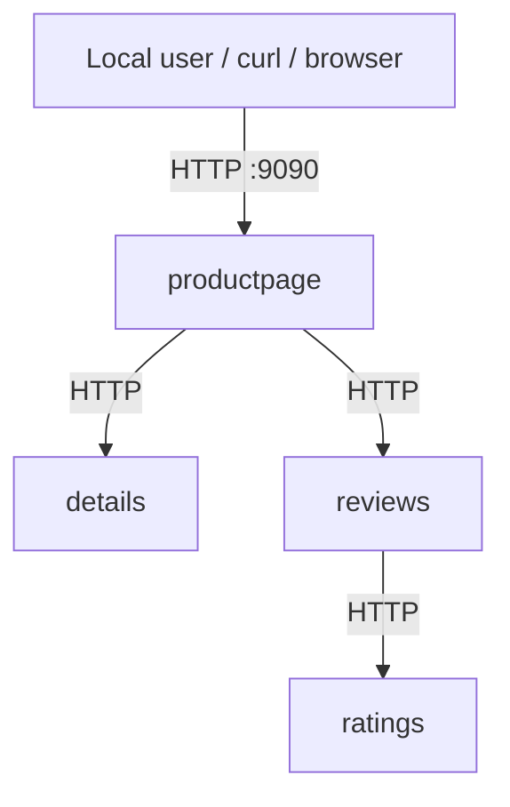
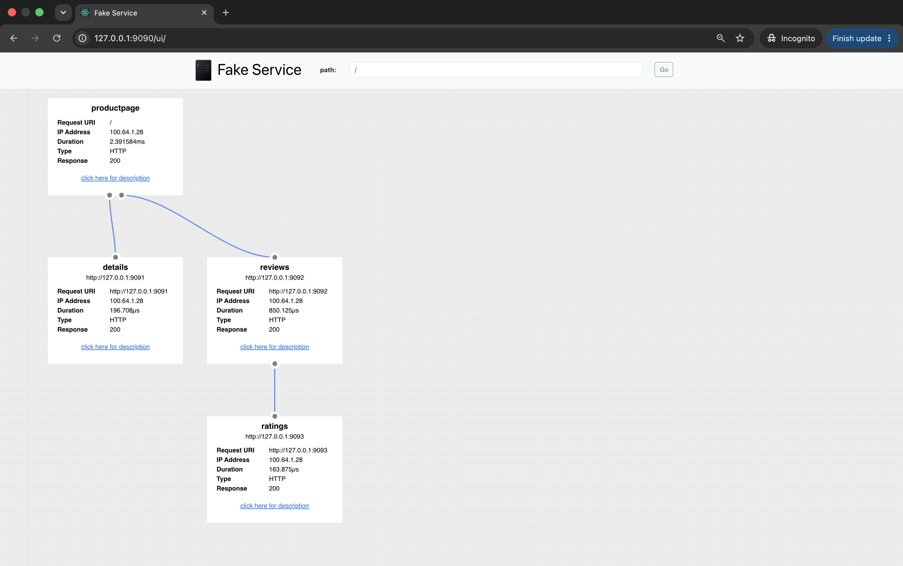
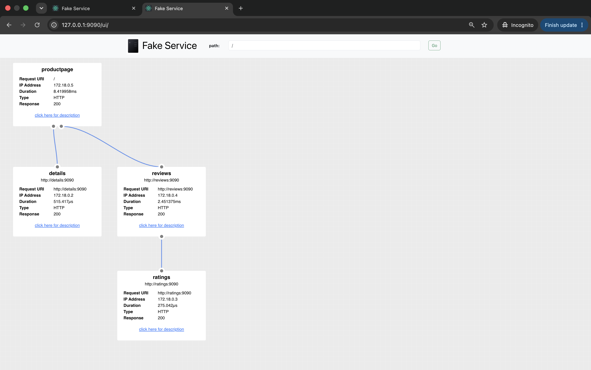
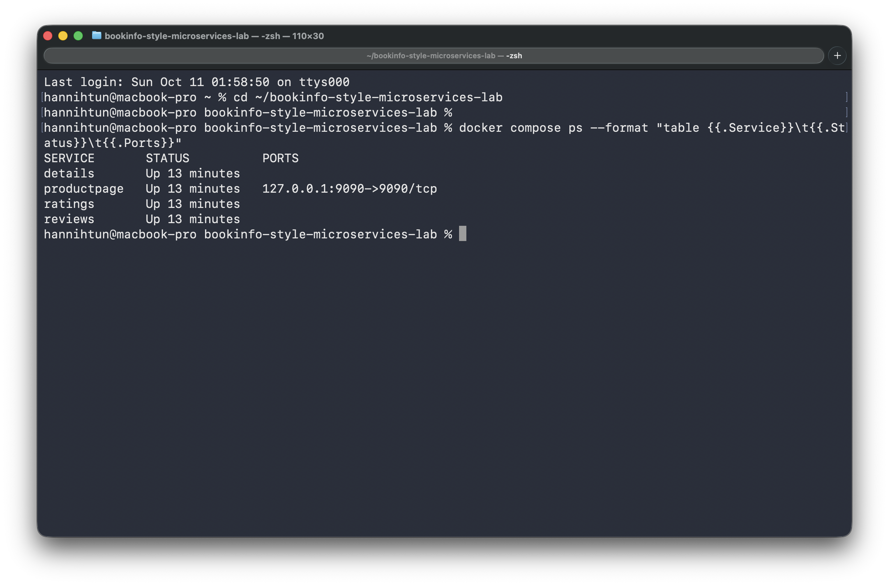
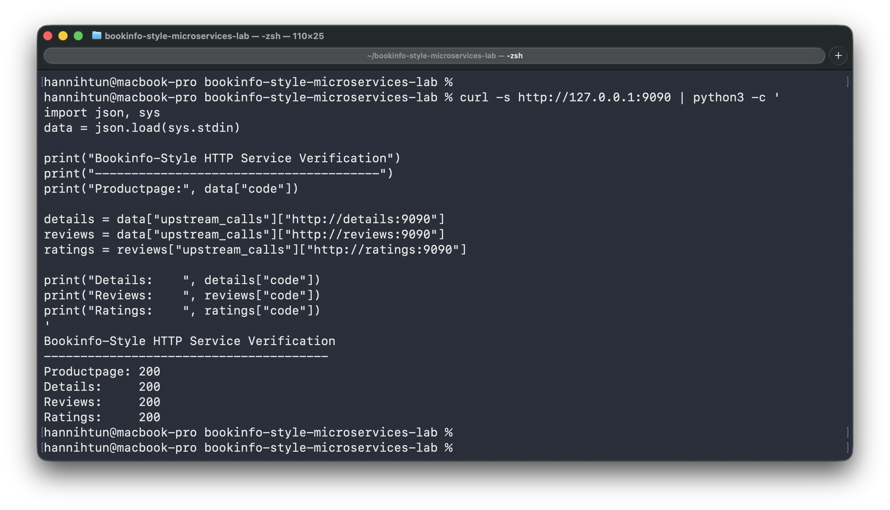
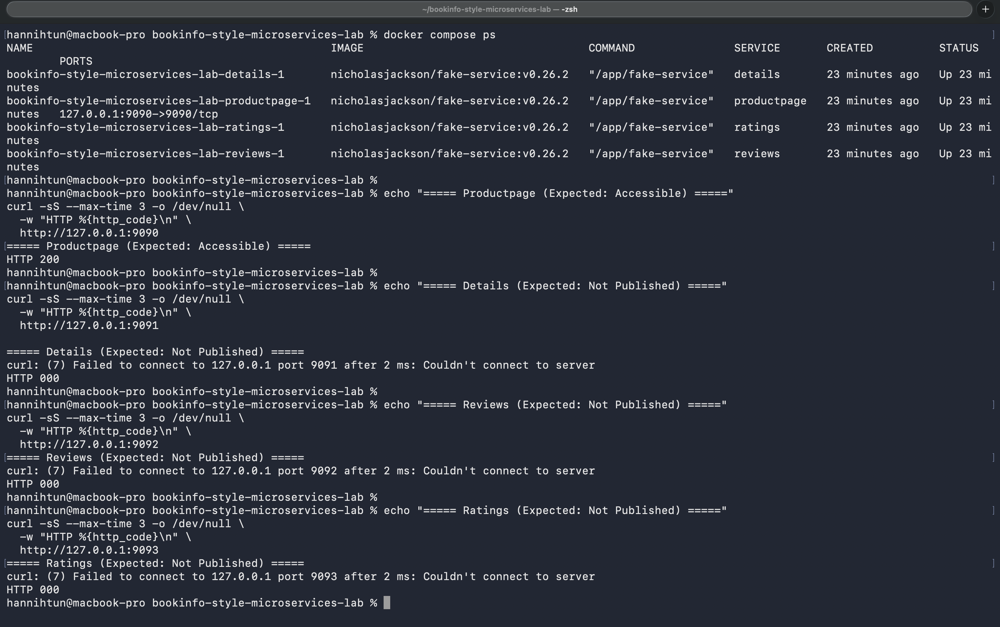

# Bookinfo-Inspired HTTP Microservices Lab | Binary & Docker Compose

A reproducible local networking lab that uses [fake-service](https://github.com/nicholasjackson/fake-service) to simulate the request flow of the [Istio Bookinfo sample](https://istio.io/latest/docs/examples/bookinfo/). The same four HTTP services are deployed in two ways: **directly on the host as native processes** and **inside Docker Compose containers**.

> **Scope:** This project **does not deploy the official Bookinfo application, Kubernetes, Istio, or a service mesh**. It reproduces the Bookinfo-inspired call graph with fake-service so that HTTP routing, upstream dependencies, Docker DNS, network namespaces, and host-port exposure can be studied independently.

## Project goals

- Model a frontend calling multiple backend services over HTTP.
- Understand upstream and downstream HTTP calls, including nested responses.
- Compare native host networking with Docker Compose networking.
- Publish **only Productpage** to the host when running Docker Compose.
- Verify HTTP responses, dependency calls, and host port accessibility using `curl`, logs, and the fake-service UI.

## Architecture



| Service | Responsibility in this simulation | Binary listening address | Compose endpoint |
| --- | --- | --- | --- |
| `productpage` | HTTP entry point; calls Details and Reviews | `127.0.0.1:9090` | `productpage:9090` (host: `127.0.0.1:9090`) |
| `details` | Returns mock book details | `127.0.0.1:9091` | `details:9090` |
| `reviews` | Returns mock reviews; calls Ratings | `127.0.0.1:9092` | `reviews:9090` |
| `ratings` | Returns mock rating data | `127.0.0.1:9093` | `ratings:9090` |

The real Bookinfo sample has more application behavior and multiple Reviews versions. This lab deliberately uses one simplified version of each service.

### Request lifecycle

1. A user requests `http://127.0.0.1:9090/`.
2. Productpage requests responses from Details and Reviews.
3. Reviews requests a response from Ratings.
4. The upstream services return their HTTP responses to the services that called them. Productpage then combines the results into a single JSON response and sends it back to the client.
5. The built-in UI at `http://127.0.0.1:9090/ui/` visualizes the request graph.

The service names and sample `MESSAGE` values are labels and mock response data; they do **not** implement a real bookstore.

## Prerequisites

- **Docker Engine and Docker Compose**: required for the containerized deployment.
- **fake-service executable**: required for the native binary deployment. Download the appropriate executable for your operating system from the [official releases](https://github.com/nicholasjackson/fake-service/releases).
- **Bash and curl**: required to run the native deployment scripts and test HTTP communication. Python 3 is used to format JSON output in the examples.
- **Available ports**: ports `9090` through `9093` for native deployment and port `9090` for Docker Compose.

**Tested environment:** Apple Silicon (ARM64), Docker Engine `29.6.1`, Docker Compose `v5.2.0`, and `nicholasjackson/fake-service:v0.26.2`.

*Note: The native deployment scripts were tested on macOS. Other operating systems may require minor adjustments.*

## Part 1: Run as Native Binaries

### 1. Obtain the executable

1. Download a compatible release from [fake-service releases](https://github.com/nicholasjackson/fake-service/releases/).
2. Extract the archive and place its `fake-service` executable in the repository root.
3. On macOS, check compatibility and enable executable permission:

```bash
file ./fake-service
chmod +x ./fake-service
```

**Note:** macOS may block the downloaded executable. If this happens, verify the source and allow it through System Settings → Privacy & Security.

### 2. Start all four services

```bash
./scripts/start-binary.sh
```

The script starts four background processes and stores logs and PID files in `.run/`, which is ignored by Git. It starts the backend services before Productpage and checks that ports 9090-9093 are available.

**Key binary-mode configuration:**

```bash
# Productpage depends on two local HTTP endpoints.
NAME=productpage \
MESSAGE="Hello from Bookinfo Product Page" \
LISTEN_ADDR=127.0.0.1:9090 \
UPSTREAM_URIS=http://127.0.0.1:9091,http://127.0.0.1:9092 \
UPSTREAM_WORKERS=2 \
./fake-service
```

`UPSTREAM_URIS` declares the services to call. `UPSTREAM_WORKERS=2` configures two upstream workers. It does not create two containers or application replicas.

### 3. Verify binary mode

```bash
# Check the HTTP entry point.
curl -i http://127.0.0.1:9090

# Display the JSON response, including nested upstream calls.
curl -s http://127.0.0.1:9090 | python3 -m json.tool
```

Expected: Productpage responds with HTTP 200. The JSON includes calls to Details and Reviews, with a nested call from Reviews to Ratings. Open `http://127.0.0.1:9090/ui/` in a browser to see the dependency graph.

### 4. Stop binary mode before using Docker

```bash
./scripts/stop-binary.sh
```

To check that port 9090 is free:

```bash
lsof -nP -iTCP:9090 -sTCP:LISTEN
```

The above check should display no listening process. If you started processes manually rather than with the script, stop those processes separately.

## Part 2: Run with Docker Compose

In Docker Compose, each service runs in its own container and can use the same internal port `9090` without conflicts. Services communicate over the Docker network using service names such as `http://details:9090`. Only Productpage publishes a port to the host.

### 1. Validate and start

```bash
# Check the YAML and resolved Compose configuration.
docker compose config -q

# Pull the upstream image and start the four services.
docker compose up -d

# Check status and host-published ports.
docker compose ps
```

All four containers use the prebuilt image `nicholasjackson/fake-service:v0.26.2`. Environment variables set each service's name, response message, and upstream connections, so no custom Dockerfile is needed.

### 2. Verify the HTTP dependency graph

```bash
# Request the frontend and display formatted JSON (Python is usually available on macOS).
curl -s http://127.0.0.1:9090 | python3 -m json.tool

# The built-in dependency graph is available in your browser at:
# http://127.0.0.1:9090/ui/
```

Expected nested calls:

```text
productpage :9090
├── details :9090
└── reviews :9090
    └── ratings :9090
```

Each node reports HTTP 200 in the successful test. The service names are resolved by Docker's network DNS, rather than by assigning fixed container IP addresses.

### 3. Verify only Productpage is published to the host

```bash
# Inspect the Docker-published ports.
docker compose ps

# The host-accessible application responds.
curl -i http://127.0.0.1:9090

# These host requests are expected to fail: no host ports are published for these services.
curl --max-time 3 http://127.0.0.1:9091
curl --max-time 3 http://127.0.0.1:9092
curl --max-time 3 http://127.0.0.1:9093
```

**Observed during this lab:** Productpage returned HTTP 200; connections to host ports 9091, 9092, and 9093 failed. `docker compose ps` showed a published port only for Productpage: `127.0.0.1:9090->9090/tcp`.

```yaml
# Productpage alone publishes a port, bound to the local host loopback interface.
ports:
  - "127.0.0.1:9090:9090"
```

**Network access:** Only Productpage publishes a host port, bound to `127.0.0.1` for local access. The backend containers still accept connections from other containers on the same Docker network. This setup is intended for a local lab, not as a complete production security policy.

### 4. Inspect running logs (optional)

```bash
# Follow requests to the frontend.
docker compose logs -f productpage

# Check backend logs without following.
docker compose logs --tail=30 details reviews ratings
```

### 5. Stop and clean up

```bash
# Remove the Compose containers and project network; leave image cache and source files intact.
docker compose down

# Confirm that the project's containers are gone.
docker compose ps
```

## Configuration reference

| Setting | Purpose | Example |
| --- | --- | --- |
| `NAME` | Human-readable service label in responses and UI | `productpage` |
| `MESSAGE` | Mock response body | `Book Details` |
| `SERVER_TYPE` | HTTP or gRPC mode (this lab uses HTTP) | `http` |
| `LISTEN_ADDR` | Interface and TCP port the process binds | `0.0.0.0:9090` in containers |
| `UPSTREAM_URIS` | Comma-separated HTTP targets invoked by a service | `http://details:9090,http://reviews:9090` |
| `UPSTREAM_WORKERS` | Number of workers used for upstream calls | `2` |
| `ports` | Host-to-container port publication | `127.0.0.1:9090:9090` |
| `depends_on` | Compose startup ordering dependency; does not guarantee application readiness | `details`, `reviews` |
| `networks` | Attaches a service to a shared Docker network | `bookinfo-network` |

The fake-service configuration options are documented in the [official repository](https://github.com/nicholasjackson/fake-service). Docker service discovery is provided by Docker Compose networking.

## Binary vs. Docker Compose: Key Lessons

| Concept | Native processes | Docker Compose |
| --- | --- | --- |
| Isolation | All services share host networking | Each service has a container network namespace |
| Listening ports | Different host ports: 9090-9093 | All containers can listen on internal port 9090 |
| Upstream addresses | `127.0.0.1:9091`, etc. | `details:9090`, `reviews:9090`, `ratings:9090` |
| Name resolution | Fixed loopback addresses/ports | Built-in Docker DNS by service name |
| Access from local host | Individual bound ports may be reachable | Only published Productpage host port is reachable |
| Lifecycle | Local PIDs and scripts | `docker compose up -d` / `docker compose down` |

## Troubleshooting encountered during the lab

| Symptom | Cause | Fix / diagnostic |
| --- | --- | --- |
| `zsh: killed` or macOS blocked an executable | macOS security check blocked the downloaded binary | Confirm binary architecture and origin; use approved macOS security workflow |
| `./fake-service: no such file or directory` or exit 127 | Wrong working directory or missing executable | Run `pwd`, `ls -l ./fake-service`, and `file ./fake-service` |
| `bind: address already in use` on 9090 | A previous Productpage process still owns the host port | `lsof -nP -iTCP:9090 -sTCP:LISTEN`, then stop the old process |
| `curl` returns connection refused | Service not listening or host port not published | Check process/container status and whether a `ports` mapping exists |
| Browser shows raw JSON rather than the diagram | Requested the HTTP endpoint instead of the UI | Open `/ui/`, e.g. `http://127.0.0.1:9090/ui/` |
| A Compose container is `Up`, but an upstream call fails | Startup ordering isn't necessarily application readiness | Review `docker compose logs` and retry when dependencies are ready; add health checks for stronger guarantees |

## Implementation Results

### 1. Native Binary Deployment

Four fake-service processes running locally, with HTTP communication between Productpage, Details, Reviews, and Ratings.



### 2. Docker Compose Deployment

The same four services running as Docker containers, communicating through Docker's internal network using service names.



### 3. Docker Container Status

All four containers are running, with only Productpage publishing port `9090` to the host.



### 4. HTTP Communication Verification

A request to Productpage successfully triggers the downstream HTTP calls. All four services return HTTP `200`.



### 5. Host Port Accessibility Verification

Productpage is accessible through `127.0.0.1:9090`, while the backend services do not publish ports to the host.




## Limitations and possible extensions

- This is a **local educational demonstration**, not production hardening.
- `depends_on` orders startup but does not guarantee dependency readiness; add health checks if reliability requirements grow.
- All services are attached to one bridge network; for stricter east–west restrictions, use additional network segmentation or platform network policies.
- Mock messages are not real Bookinfo business logic, and service IPs can change across container restarts.
- Distributed tracing with Jaeger, OpenTelemetry instrumentation, Kubernetes, and Istio are potential **future extensions**, **not features implemented or validated in this repository**.

## References and attribution

- [fake-service GitHub repository](https://github.com/nicholasjackson/fake-service) (third-party application and configuration documentation)
- [fake-service releases](https://github.com/nicholasjackson/fake-service/releases) (native executables)
- [fake-service on Docker Hub](https://hub.docker.com/r/nicholasjackson/fake-service) (container image)
- [Istio Bookinfo application](https://istio.io/latest/docs/examples/bookinfo/) (architecture inspiration)
- [Docker Compose networking](https://docs.docker.com/compose/how-tos/networking/) (container service discovery)

**Attribution:** The upstream `fake-service` application and container image are authored and distributed by their respective maintainers. This repository contains original lab configuration, scripts, and documentation; it does not claim authorship of fake-service or the official Istio Bookinfo sample.
